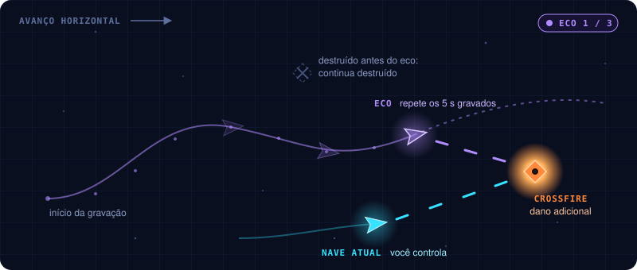
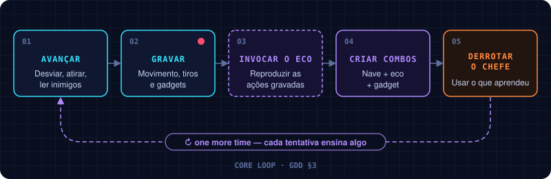

# BILU'S INVASION | GDD de uma página

O jogo inteiro numa página. A versão visual, [`gdd.html`](gdd.html), é gerada a partir deste arquivo.
Cada bloco aponta para o capítulo do GDD completo, em [`gdd/`](gdd/), que guarda os detalhes.

**O passado continua lutando.**

Um shooter de nave em que o jogador grava e reproduz suas próprias ações passadas para lutar ao mesmo
tempo com versões anteriores de si mesmo, desviar de armadilhas e explorar combinações temporais para
derrotar chefes. Cada tentativa deixa para trás ações que viram estratégia: *One More Time*.

| | |
|---|---|
| Gênero | Shooter side-scrolling **2.5D** (mundo 3D, câmera lateral de leitura 2D) com padrões de bullet hell |
| Modo | Single-player |
| Plataforma | PC |
| Motor | Unity 6 (6000.3), URP, Input System |
| Visual | Mundo e jogabilidade em 3D; parte dos elementos serão sprites 2D; pixelado, como o *Star Fox* do SNES → [08](gdd/08-direcao-visual-e-sonora.md) |
| Estrutura | Runs curtas de 5–10 min: encontros de combate e um chefe |
| Contexto | Protótipo para game jam |

## O loop → [02](gdd/02-eco-temporal.md)

**Avançar** (desviar, atirar, ler inimigos) → **Plantar âncora** (gravar movimento, tiros, gadgets) → **Retornar e soltar o eco**
→ **Criar combos** (nave + eco + armadilhas) → **Derrotar o chefe**.

## O eco temporal → [02](gdd/02-eco-temporal.md)

Toque **Shift** para plantar uma âncora e gravar até **3,5 s** de posição, mira, inclinação, tiros e gadgets.
Toque **Shift** novamente — ou deixe o tempo acabar — para voltar ao ponto plantado. A sombra que seguia a
nave volta à âncora e repete a rota enquanto você continua pilotando. Há **um eco ativo** nessa primeira versão.

**Regra fundamental:** o eco reproduz as ações, mas não rebobina o mundo. O que morreu continua morto.

## Combate → [03](gdd/03-combate.md)

Movimento em 8 direções independente da mira, disparo contínuo na direção do mouse, retículo pulsante, recoil, flash e squash a cada tiro, além de um gadget. Acertos piscam e soltam faíscas; escudos defletem; destruições deixam explosão, anel e impulso de câmera proporcionais. Três tipos de dano: direto, de gadget e combinado.
Cinco combos temporais: **Crossfire**, **Trap Bait**, **Double Pulse**, **Reflect Chain**, **Synchronized Strike**.
No protótipo, os dois primeiros a existir: **Crossfire** (nave e eco acertam o mesmo alvo em até 1 s: dano
combinado) e **Synchronized Strike** (um gerador do Guardião pela nave, o outro pelo eco, em até 2,5 s: o
escudo do núcleo cai). Janelas generosas, valores de partida.

## Inimigos → [04](gdd/04-inimigos-e-ondas.md)

**Caça** (S: entra em fila, mergulha e dispara), **Interceptador** (W: cruza em senoide com rajadas de 2),
**Artilheiro** (M: oscila à direita e dispara leques de 5) e **Torreta** (planejada). Ondas por script,
nunca aleatórias: o encontro atual comprime 15 entradas e 66 inimigos em 54 s, com pressão crescente e
sobreposições legíveis. Cada família sorteia um de três modelos; só o visual muda.

## Armadilhas, gadgets, puzzles → [05](gdd/05-armadilhas-gadgets-puzzles.md)

Laser gate, laser rotativo, campo de minas, barreiras móveis. Gadgets: mina temporal e pulso de
interferência (escudo refletor e arpão magnético são expansão). Puzzles de poucos segundos, resolvidos
dividindo a tarefa entre a nave e o eco. No protótipo: laser gate, barreira móvel e um interruptor que o
eco segura enquanto está sobre ele; a mina temporal (Q), que o eco também solta.

## O chefe → [06](gdd/06-chefe-e-runs.md)

**O Guardião do Ciclo** (provisório): Sobrevivência → Preparação → Sincronização → Última chance.
Vencível com boa sequência temporal, nunca pixel-perfect. No protótipo, as fases 1 a 3: os dois
geradores precisam cair dentro de uma janela para o núcleo ficar vulnerável. Com o modelo do designer, visto
de lado como as naves, ele aponta dois braços-canhão para a nave, em alturas diferentes, com um gerador na
ponta de cada um; o visor, no alto, é o núcleo. Durante o combate ele deriva numa faixa curta e acelera os
padrões a cada fase.

## Controles e HUD → [07](gdd/07-controles-e-interface.md)

WASD/setas movem · mouse mira · Espaço/clique atira · **Shift** grava · **E** invoca · **Q** gadget · Esc pausa.
Com controle: stick esquerdo move · stick direito mira · RT atira · **LT** grava · **RB** invoca · **LB** gadget · Start pausa. A tela de controles troca qualquer tecla ou botão.
O jogo abre num menu inspirado no *Star Fox 64*: título, menu (jogo, controles, som, créditos), mapa de missões, história que sobe pela tela e, na arena, o cartão "Missão Nº 1".
O HUD mostra integridade, memória temporal, ecos ativos, gadget, vida do chefe e combos.

## Visual e som → [08](gdd/08-direcao-visual-e-sonora.md)

2.5D: mundo 3D visto por câmera lateral, com alguns sprites 2D. Arcade sci-fi. **Ciano** é você, **eco translúcido** é o seu passado, **laranja e vermelho** é perigo.
No protótipo, o mundo é desenhado em baixa resolução (270 px de altura) e ampliado sem suavizar, como no *Star Fox* do SNES; o HUD fica nítido.
O som também explica: a gravação pulsa, a invocação reverte, o eco soa filtrado. No protótipo isso já toca; a música muda a cada encontro.

## Escopo da jam → [10](gdd/10-producao.md)

**MVP:** nave, uma arena, âncora com rota de até 3,5 s, retorno e reprodução, drones por script, duas armadilhas, um gadget,
um chefe com janela de vulnerabilidade, vitória e derrota. O teste que importa: alguém joga sem
explicação e descobre sozinho para que serve o eco.

## Protótipo — estado atual → [10](gdd/10-producao.md)

Jogável em `Assets/_Project/Scenes/Arena_01.unity`. Nave, eco, inimigos e chefe usam os modelos 3D de
blockout do designer; o resto ainda é placeholder (primitivas 3D). Tem: nave, tiro,
âncora temporal com retorno e eco que repete movimento, tiros e gadget, caças, interceptadores e artilheiros que atiram, em ondas por script,
corredor de armadilhas (laser gate, barreira móvel, interruptor), mina temporal, o Guardião do Ciclo
(fases 1 a 3), os combos Crossfire e Synchronized Strike com aviso no HUD, HUD, pausa, derrota (o encontro
atual recomeça), vitória (derrotar o Guardião), o fluxo de menus (título, menu, mapa de missões, história e cartão de missão) e som: efeitos e música CC0 ligados ao jogo, com os valores ainda por ajustar de ouvido.
Faltam torreta, os outros três combos, pulso de interferência, a fase 4 do chefe e o encontro 3 (Combinação).

## Perguntas em aberto

- Chefe com quatro fases ou duas? → [06](gdd/06-chefe-e-runs.md)
- Um ou dois gadgets no MVP? → [05](gdd/05-armadilhas-gadgets-puzzles.md)
- Um ou até três ecos no MVP? → [02](gdd/02-eco-temporal.md)
- Regra do eco para dispositivos de presença contínua → [02](gdd/02-eco-temporal.md)
- A gravação é relativa à tela: o protótipo para a rolagem nos puzzles; vira regra? → [02](gdd/02-eco-temporal.md)
- Ajustes do Guardião: núcleo aberto já na fase 2, geradores sem regeneração e tamanho sugerido pelo designer → [06](gdd/06-chefe-e-runs.md)
- Janelas dos combos (1 s e 2,5 s) e se só o Synchronized Strike deve abrir o núcleo → [03](gdd/03-combate.md)
- Quais elementos são modelos 3D e quais são sprites 2D; lente de 300 mm sugerida pelo designer → [08](gdd/08-direcao-visual-e-sonora.md)
- Donos de cada capítulo, datas e equipe da jam → [10](gdd/10-producao.md)

## O GDD completo

Um capítulo por arquivo em [`gdd/`](gdd/), ordenado das regras para a sensação (mecânica → dinâmica →
estética) e depois produção. Versão visual: [`gdd-full.html`](gdd-full.html).

| # | Capítulo | Dono | Status |
|---|---|---|---|
| 01 | [Visão geral](gdd/01-visao-geral.md) | _TBD_ | draft |
| 02 | [Loop e eco temporal](gdd/02-eco-temporal.md) | _TBD_ | draft |
| 03 | [Combate](gdd/03-combate.md) | _TBD_ | draft |
| 04 | [Inimigos e ondas](gdd/04-inimigos-e-ondas.md) | _TBD_ | draft |
| 05 | [Armadilhas, gadgets e puzzles](gdd/05-armadilhas-gadgets-puzzles.md) | _TBD_ | draft |
| 06 | [Chefe e estrutura das runs](gdd/06-chefe-e-runs.md) | _TBD_ | draft |
| 07 | [Controles e interface](gdd/07-controles-e-interface.md) | _TBD_ | draft |
| 08 | [Direção visual e sonora](gdd/08-direcao-visual-e-sonora.md) | _TBD_ | draft |
| 09 | [Arquitetura técnica](gdd/09-arquitetura-tecnica.md) | _TBD_ | draft |
| 10 | [Produção — escopo da jam](gdd/10-producao.md) | _TBD_ | draft |

Capítulos novos começam de [`gdd/_template.md`](gdd/_template.md), que também guarda as convenções.
O PDF original, a fonte de tudo isto, fica em [`source/`](source/GDD_One_More_Time_v0.1.pdf).
