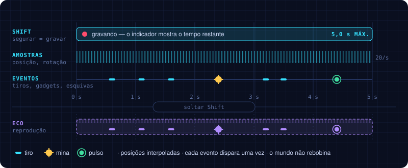

# BILU'S INVASION | Loop e eco temporal

O loop central do jogo e o sistema que o sustenta: o que é gravado, como o eco nasce e as regras que o mantêm previsível.

## Core gameplay loop

O jogo gira em torno de aprender os padrões, gravar ações úteis e usá-las para criar oportunidades de ataque.

| Passo | O jogador… |
|---|---|
| **Avançar** | desvia, atira e lê os inimigos |
| **Plantar âncora** | marca o retorno e registra movimento, tiros e gadgets |
| **Retornar** | leva a nave à âncora e solta o eco para reproduzir as ações |
| **Criar combos** | combina nave + eco + armadilhas |
| **Derrotar o chefe** | usa o conhecimento adquirido |

## O que o jogador grava

O sistema registra uma sequência de ações da nave numa janela de **até 3,5 segundos**.

| Dado | Comportamento |
|---|---|
| Posição | A posição da nave ao longo do tempo |
| Mira e inclinação | A direção apontada pelo mouse e a inclinação visual da nave |
| Disparos | Instante, tipo e direção de cada tiro |
| Gadgets | Momento e direção de uso |
| Duração | Até 3,5 segundos por gravação |
| Reprodução | Uma cópia independente repete a sequência |
| Limite | 1 eco ativo nesta primeira versão |

A gravação **não é um replay de vídeo**: é uma lista de dados que permite reproduzir os eventos da nave
→ [09](09-arquitetura-tecnica.md).

## Ciclo de gravação

1. O jogador **toca Shift**: planta a âncora e a gravação começa.
2. Uma sombra violeta segue a nave com pequeno atraso. Ela é somente uma prévia visual: não atira e não colide.
3. O jogo armazena até 3,5 segundos de movimento, mira, tiros e gadgets; a rota fica desenhada no campo.
4. O jogador **toca Shift novamente**, ou o tempo se esgota.
5. A nave retorna instantaneamente à âncora e a sombra volta para o início da rota.
6. O eco executa a sequência na mesma ordem enquanto o jogador age livremente a partir da âncora.
7. Depois da reprodução o eco desaparece e a habilidade respeita 2 segundos de recarga.

Durante a reprodução o jogador continua controlando a nave atual, mas só planta outra âncora quando o eco
termina e a recarga está pronta.

A gravação tem um **indicador visual de tempo restante**, para o jogador planejar sem olhar o tempo
todo para a interface → [07](07-controles-e-interface.md).

## Regra fundamental

> O eco **reproduz as ações, mas não restaura o estado do mundo.** Inimigos mortos não voltam,
> projéteis destruídos não reaparecem e armadilhas seguem suas regras atuais.

*Por quê:* evita a complexidade de rebobinar a simulação inteira e torna o sistema mais previsível.

## Limites e consistência

| O eco… | Regra |
|---|---|
| Decide? | Não. Não toma decisões nem corrige a trajetória |
| Persegue inimigos? | Não. A reprodução não muda de direção |
| Atira para onde? | Para a direção registrada |
| Colide com a nave atual? | Não |
| Recebe dano? | Não, de projéteis comuns (no protótipo) |
| Usa gadgets? | Sim, e obedece às regras de cada gadget |
| Quantos ao mesmo tempo? | Limitado, para a tela não ficar ilegível |

**Dispositivos de presença contínua.** Um eco pode manter um interruptor ativado enquanto sua trajetória
permanece sobre ele, mas não ativa um mecanismo só por passar perto — a menos que essa seja a regra
explícita do objeto.

## No protótipo atual

| Regra | Como está implementado |
|---|---|
| Espaço da gravação | Posições relativas à **tela** (o playfield que rola), não ao mundo: o eco refaz o mesmo trajeto na tela mesmo com a câmera avançando |
| Um botão | Shift planta a âncora; o próximo toque retorna. E fica apenas como alias temporário de compatibilidade durante a gravação e não aparece no HUD |
| Retorno | Volta só a posição da nave; não cura e não restaura o mundo. Concede 0,2 s de invulnerabilidade e apaga projéteis inimigos num raio de 1,6 unidade ao redor da âncora |
| Limite de 3,5 s | Ao completar a janela, o retorno acontece automaticamente |
| Prévia | Uma cópia inofensiva segue a nave com 0,18 s de atraso, acompanhada por âncora pulsante e rastro da rota |
| Ecos ao mesmo tempo | 1 (`EchoConfig.maxActiveEchoes`), para o sincronismo ficar legível |
| Recarga | 2 s a partir do retorno; uma nova âncora também espera o eco atual terminar |
| Corpo do eco | Sem colisor e sem vida: não bloqueia a nave nem recebe dano |
| Entrada e saída | O eco aparece e some com um fade de 0,2 s |
| Mira | A direção é amostrada junto da pose; o eco gira para a mira gravada e cada tiro usa sua direção registrada |
| Gadget | O uso da mina temporal entra na gravação (`EchoEventType.Gadget`); o eco solta a mina no mesmo ponto e instante → [05](05-armadilhas-gadgets-puzzles.md) |
| Interruptores | O eco segura um interruptor enquanto está sobre a placa. O interruptor confere posições, não colisões, então o eco sem colisor também conta → [05](05-armadilhas-gadgets-puzzles.md) |
| Puzzles fixos no mundo | A rolagem para no trecho do interruptor (`TrapSection` zera `Playfield.ScrollSpeed`), então o eco volta ao ponto onde foi gravado |

*Por quê:* num side-scroller a tela anda o tempo todo; gravar em coordenadas do mundo deixaria o eco
para trás, fora da tela, poucos segundos depois.

## Perguntas em aberto

- [ ] Regra final para dispositivos que exigem presença contínua: o GDD v0.1 marca como decisão da versão final. O protótipo segura o interruptor só enquanto o eco ou a nave está sobre a placa, com 0,15 s de folga ao sair.
- [ ] O eco recebe dano de projéteis especiais ou do chefe? O v0.1 só diz "comuns, no protótipo".
- [x] Ecos simultâneos no MVP: a primeira versão usa um eco ativo para privilegiar leitura e intenção. Mais ecos ficam como expansão → [10](10-producao.md).
- [ ] Puzzles com interruptores fixos no mundo (Puzzle 1) e gravação relativa à tela: a rolagem para nesses trechos (`Playfield.ScrollSpeed = 0`) ou o eco grava em coordenadas do mundo ali? O protótipo para a rolagem; falta confirmar como regra → [05](05-armadilhas-gadgets-puzzles.md)
- [x] A rota é consumida no retorno; cada eco exige uma nova âncora e uma nova rota.
