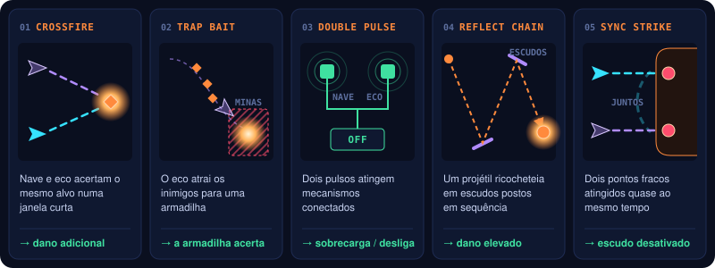

# ONE MORE TIME | Combate

O que a nave do jogador faz, os tipos de dano, os combos temporais e o que a pontuação premia.

## Nave do jogador

A nave começa com um conjunto pequeno de ações:

- Movimento em **oito direções** dentro da área jogável.
- **Disparo principal** contínuo.
- Um **gadget** equipado → [05](05-armadilhas-gadgets-puzzles.md).
- A habilidade de **gravação e reprodução** temporal → [02](02-eco-temporal.md).
- Vida limitada e **invulnerabilidade breve** depois de receber dano.

O jogador atira enquanto se move. O foco é esquivar e se posicionar, não alternar o tempo todo entre
movimento e ataque.

## Valores de partida no protótipo

| Item | Valor | Onde mudar |
|---|---|---|
| Integridade da nave | 3 | `PlayerShip` → `Health` |
| Invulnerabilidade após dano | 1,2 s | `PlayerShip` → `Health` |
| Velocidade da nave | 9 u/s | `PlayerShip` → `ShipMotor` |
| Disparo principal | 10 tiros/s, dano 1 | `PlayerShip` → `ShipWeapon`, `Shot_Ship` |
| Drone | 2 de vida, 100 pontos | `Drone` |
| Ondulante | 1 de vida, 100 pontos | `Ondulante` |
| Inimigo que bate na nave | 1 de dano | `ContactDamage` |
| Mina temporal | 4 de dano de gadget num raio de 2,4 u; recarga de 1,5 s | `TimeMine_Ship`, `TimeMine_Echo`, `PlayerShip` → `ShipGadget` |
| Laser gate e barreira móvel | 1 de dano ao contato | prefabs em `Prefabs/Traps` |
| Tiros do Guardião | 1 de dano | `Shot_Enemy` |
| Guardião | núcleo 120 de vida, geradores 12 | `Guardian` → [06](06-chefe-e-runs.md) |
| Crossfire | janela de 1 s entre o acerto da nave e o do eco; +3 de dano combinado; o mesmo alvo só dá outro Crossfire depois de 1 s | `ComboTracker` (cena, em `Systems`) |
| Synchronized Strike | janela de 2,5 s entre a queda dos dois geradores | `ComboTracker` |

Valores para testar, não definitivos.

## Tipos de dano

| Tipo | Origem |
|---|---|
| **Direto** | Tiros convencionais da nave |
| **De gadget** | Minas, pulsos ou ataques especiais |
| **Combinado** | Efeitos especiais ativados quando as ações da nave atual e do eco coincidem |

Só três categorias, para simplificar o protótipo. O código também marca o dano de **contato** (um inimigo
que bate na nave), que o GDD v0.1 não lista.

O protótipo separa os tiros da nave dos tiros do eco (`ShotSource`), e é isso que os combos usam.
O dano de gadget é o da mina temporal → [05](05-armadilhas-gadgets-puzzles.md). O dano combinado é o bônus
do Crossfire.

## Combos temporais

Os combos são **eventos específicos** que o jogo reconhece, não multiplicadores genéricos.

| Combo | Condição | Resultado |
|---|---|---|
| **Crossfire** | Nave atual e eco acertam o mesmo alvo numa janela curta | Dano adicional |
| **Trap Bait** | O eco atrai inimigos para uma armadilha | Inimigos atingidos pela armadilha |
| **Double Pulse** | Dois pulsos atingem mecanismos conectados | Sobrecarga ou desativação |
| **Reflect Chain** | Um projétil ricocheteia em escudos posicionados em sequência | Dano elevado ao alvo |
| **Synchronized Strike** | Dois pontos fracos são atingidos quase ao mesmo tempo | Escudo do chefe desativado |

Cada combo tem **feedback visual e sonoro próprio** → [08](08-direcao-visual-e-sonora.md).

*Por quê:* o jogador precisa entender por que a combinação funcionou — é assim que ele aprende a repeti-la.

### No protótipo atual

Dois dos cinco combos existem: **Crossfire** e **Synchronized Strike**. Os dois partem de acertos reais da
nave e do eco: um tiro ou uma mina conta para quem o disparou, a nave atual ou um eco.

| Combo | Como o jogo reconhece | Resultado |
|---|---|---|
| **Crossfire** | A nave e um eco acertam o **mesmo alvo** (inimigo, gerador ou núcleo do Guardião) com até **1 s** de diferença. Dois acertos da mesma fonte não contam. Cada par de acertos dá um combo só, e o mesmo alvo só dá outro depois de 1 s | **+3 de dano combinado** no alvo, se ele ainda estiver vivo, e **100 pontos** |
| **Synchronized Strike** | Os dois geradores do Guardião caem com até **2,5 s** de diferença, **um derrubado pela nave e o outro por um eco**, e o núcleo fica vulnerável | O **escudo do núcleo cai**, pela regra do próprio Guardião → [06](06-chefe-e-runs.md), e **1000 pontos** |

Os dois ficam no `ComboTracker`; as regras, em `CrossfireRule` e `SynchronizedStrikeRule` (Core, com testes).
O feedback, por enquanto, é só o aviso no HUD → [07](07-controles-e-interface.md): o nome do combo e o que o
causou. Ainda não há som nem efeito no mundo.

Os tamanhos das janelas são **valores de partida**, generosos de propósito (o §16 pede janelas de
sincronização generosas no começo): 1 s para o Crossfire; 2,5 s para o Synchronized Strike, o mesmo da
janela curta da fase 3 do Guardião. Falta validar jogando.

*Por quê:* derrubar os geradores sem o eco ainda abre o núcleo, se o jogador for rápido o bastante
(pergunta em aberto em [06](06-chefe-e-runs.md)). O Synchronized Strike não muda essa regra: ele reconhece e
premia quando a abertura veio da nave e do eco juntos.

## Pontuação por habilidade

O jogo pode premiar:

- Combos temporais.
- Inimigos eliminados por armadilhas.
- Sequências sem sofrer dano.
- Sincronizações precisas.
- Destruição de projéteis ou mecanismos usando o ambiente.

A pontuação **não é necessária** para terminar a fase. Ela incentiva o domínio da mecânica e a rejogabilidade.

No protótipo atual a pontuação é **100 por inimigo abatido**, **250 por gerador do Guardião**, **5000 pelo núcleo**,
**100 por Crossfire** e **1000 por Synchronized Strike**, como placeholder. Dos prêmios acima, só os combos temporais
existem. A tela de vitória mostra quantos combos o jogador fez.

## Perguntas em aberto

- [ ] Valores de vida, dano e invulnerabilidade: os de partida estão na tabela acima; falta validar jogando.
- [ ] O dano de contato entra como quarta categoria, ou é parte do dano direto?
- [ ] Combos temporais: Crossfire e Synchronized Strike implementados; faltam Trap Bait, Double Pulse e Reflect Chain. Trap Bait depende de armadilhas que firam inimigos, e as do protótipo só ferem a nave; Double Pulse depende do pulso de interferência; Reflect Chain, do escudo refletor (expansão).
- [ ] Tamanho da "janela curta" de Crossfire e Synchronized Strike: o protótipo usa 1 s e 2,5 s como valores de partida (§16 pede janelas generosas no começo). Falta validar jogando.
- [ ] Crossfire: o bônus (+3 de dano combinado) e o intervalo de 1 s antes de o mesmo alvo dar outro combo são valores de partida, não vêm do v0.1.
- [ ] Synchronized Strike: deve ser a **única** forma de abrir o núcleo (o que responderia à pergunta dos geradores sem regeneração em [06](06-chefe-e-runs.md)), ou continua só reconhecendo e premiando a abertura feita com o eco?
- [ ] Feedback próprio de cada combo: o protótipo só tem o aviso no HUD; faltam o som exclusivo e um efeito no mundo → [08](08-direcao-visual-e-sonora.md).
