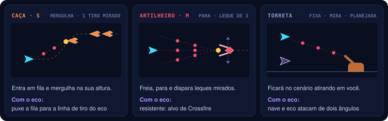
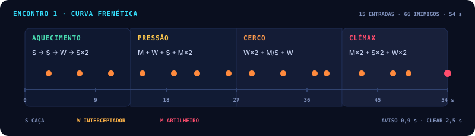

# ONE MORE TIME | Inimigos e ondas

Quem a nave enfrenta, como cada inimigo conversa com o eco, e como as ondas entram na tela.

Os inimigos surgem durante o avanço da fase, entrando pela direita (e às vezes por cima ou por baixo).
Em vez de spawn aleatório, cada encontro segue uma **lista de ondas com tempo e posição definidos**.

*Por quê:* o jogador aprende o padrão e consegue planejar o que gravar no eco.

## Tipos de inimigo

| Inimigo | Comportamento | Papel com o eco |
|---|---|---|
| **Caça** (S, pequeno) | Entra em fila pela direita, em linha reta. Num ponto da tela mergulha para a altura em que a nave está naquele momento, avisa com um brilho e dispara **um** tiro mirado; depois segue e sai pela esquerda | Como mergulha atrás da nave, dá para puxar a fila para a linha de tiro do eco |
| **Artilheiro** (M, médio) | Entra, freia e segura uma posição à direita, balançando de leve. A cada rajada avisa com um brilho e dispara um **leque de 3 tiros** mirados; depois de um tempo acelera e sai pela esquerda | Resistente e parado: o alvo natural de Crossfire (nave e eco no mesmo alvo) |
| **Torreta** *(planejada)* | Parada no cenário, atira na direção da nave | Exige que nave e eco ataquem de posições diferentes |

O GDD v0.1 previa um **drone** (linha reta, sem atirar) e um **ondulante** (zigue-zague em grupos). Em
2026-10-18 o time pediu inimigos melhores, que atirem; caça e artilheiro ocuparam esses dois lugares, com
os modelos de blockout do designer → [08](08-direcao-visual-e-sonora.md).

Cada tipo tem **três variações de modelo**, e cada inimigo sorteia uma ao surgir. A variação muda só o
visual: caminho, tiro, vida e pontos são os do tipo, e as ondas continuam por script. A hitbox e o ponto de
onde sai o tiro acompanham o modelo sorteado.

*Por quê:* uma fila de caças iguais parece um carimbo; com peças e cabeças diferentes, a onda parece um
esquadrão, sem mudar o que o jogador aprende sobre cada tipo.

Para a jam, a recomendação do v0.1 era **começar com um tipo** e adicionar os outros só se o núcleo já
estivesse divertido; o protótipo tem dois.

*Por quê:* os dois cobrem as duas pressões clássicas de um shooter de nave — o caça é rápido e frágil e
obriga a sair da linha do tiro; o artilheiro é lento e resistente e obriga a gastar tempo nele, o que pede
o eco.

## Valores de partida no protótipo

| | Caça (S) | Artilheiro (M) | Onde mudar |
|---|---|---|---|
| Vida | 1 | 20 | prefab → `Health` |
| Pontos | 100 | 300 | prefab → `Enemy` |
| Modelo | sorteado entre 3 variações | sorteado entre 3 variações | prefab → `ModelVariants` |
| Movimento | 6,5 u/s; mergulha a 30% da meia largura à direita do centro, em 1 s, no máximo 4,5 u para cima ou para baixo | entra em 1,6 s até 4,5 u da borda direita; segura 7 s balançando 0,5 u (0,3 Hz); sai acelerando a 5 u/s² | prefab → `Enemy` |
| Tiro | 1 tiro mirado, 0,35 s depois do início do mergulho | leque de 3 tiros mirados, 12° entre eles; a primeira rajada 0,8 s depois de parar, depois a cada 1,8 s | prefab → `EnemyGun` |
| Aviso antes do tiro | 0,35 s | 0,45 s | prefab → `EnemyGun` |
| Tiro inimigo | 8 u/s, 1 de dano (o mesmo do Guardião) | | `Shot_Enemy` |
| Encostar na nave | 1 de dano | 1 de dano | `ContactDamage` |

Valores para testar, não definitivos. As regras dos caminhos e do tiro ficam no Core (`SwoopMotion`,
`HoverMotion`, `FireCycle`), com testes.

## Regras de surgimento

- As ondas são definidas por script: tempo de entrada, ponto de entrada, tipo e quantidade.
- Cada onda **sinaliza a entrada** com um aviso visual curto (no protótipo, um marcador piscando na borda direita, 0,8 s antes).
- Cada rajada inimiga é **avisada**: um brilho amarelo pisca na ponta do inimigo antes do tiro.
- Inimigo só atira com a ponta **dentro da tela**: nada atira de onde o jogador não vê.
- Inimigos que saem pela esquerda são removidos **sem penalidade**.
- O número de inimigos simultâneos é limitado, para a tela continuar legível com os ecos ativos.
- Matar inimigos **nunca é obrigatório** para avançar; o scroll continua.

Dois artilheiros na mesma onda ficam em alturas diferentes (duas fileiras); se a onda tiver mais de um na
mesma fileira, cada um para mais à direita que o anterior, mantendo a distância com que entrou.

## Exemplo — Encontro 1 (primeiro ciclo)

| Tempo | Onda | Objetivo de design |
|---|---|---|
| 0:00 – 0:10 | Sem inimigos | Aprender movimento, tiro e gravação |
| 0:10 – 0:25 | 4 caças em fila no alto (0:10) e 4 embaixo (0:17) | Primeiros alvos; aprender a sair da linha do tiro mirado |
| 0:25 – 0:35 | O primeiro artilheiro, no meio da tela | Gravar o tiro e cruzar com o eco: o primeiro alvo para Crossfire |
| 0:35 – 0:44 | Caças em dois níveis | Deixar o eco cobrir um nível |
| 0:44 – 0:55 | Dois artilheiros, um em cima e outro embaixo | Dividir as tarefas entre nave e eco |
| 0:55 – 1:10 | 5 caças pelo meio (0:55); um artilheiro com escolta de caças (1:02) | Ler e priorizar os alvos |
| 1:10 – 1:20 | Caças finais em dois níveis (1:13) | Fechar antes do corredor |

Está em `Encounter01_PrimeiroCiclo.asset`. O encontro termina 4 s depois da última onda, quando não resta
inimigo vivo; aí começa o corredor de armadilhas → [06](06-chefe-e-runs.md). A torreta ainda não entra.

Os tempos são valores de partida para testar. As ondas dos encontros 2 e 3 devem reaproveitar os mesmos
inimigos, combinados com as armadilhas e o gadget → [06](06-chefe-e-runs.md).

## Perguntas em aberto

- [ ] Limite de inimigos simultâneos na tela: `_TBD_` (o protótipo ainda não limita).
- [ ] Torreta: falta implementar.
- [ ] O caça mira e mergulha para onde a nave está: as ondas continuam por script, mas parte do movimento responde ao jogador. Isso combina com "o jogador aprende o padrão e planeja o que gravar", ou o mergulho deve ir para alturas fixas?
- [ ] Vida, pontos, tempos de tiro e de aviso: valores de partida; falta validar jogando.
- [ ] Ondas dos encontros 2 e 3: só o encontro 1 tem linha do tempo.
