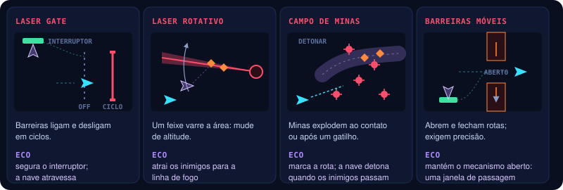
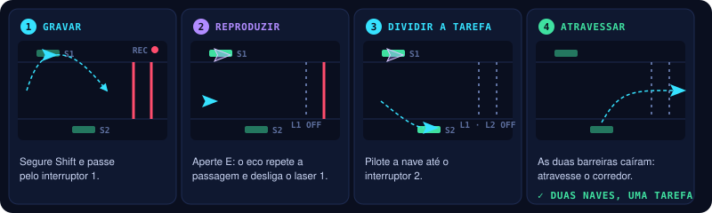

# ONE MORE TIME | Armadilhas, gadgets e puzzles

O cenário que desafia o movimento, as ferramentas que a nave carrega e os puzzles que só se resolvem com o eco.

## Armadilhas e obstáculos

As armadilhas são parte central do jogo: desafiam a movimentação **e** permitem soluções com os ecos.

| Armadilha | Desafio | Interação temporal |
|---|---|---|
| **Laser gate** | Barreiras que ligam e desligam em ciclos; atravessar no momento seguro | O eco ativa um interruptor que desliga uma barreira enquanto a nave atravessa outra |
| **Laser rotativo** | Um feixe varre a área e obriga a mudar de altitude | O eco atrai inimigos para a linha de fogo, ou repete uma sequência de ativação de escudos |
| **Campo de minas** | Minas explodem ao contato ou depois de um gatilho | A nave dispara um detonador quando os inimigos passam pela região registrada pelo eco |
| **Barreiras móveis** | Obstáculos que abrem e fecham rotas; exigem precisão | O eco mantém um mecanismo num estado, abrindo uma janela de passagem |

> Para a jam, implemente **apenas dois tipos de armadilha e uma variação de obstáculo**. A variedade
> vem das combinações com o eco, não da quantidade de objetos diferentes.

## Gadgets

A nave carrega **um gadget por vez** no protótipo. O objetivo é criar escolhas táticas sem sobrecarregar os controles.

| Gadget | Função principal | Interação temporal | Escopo |
|---|---|---|---|
| **Mina temporal** | Explode por proximidade ou detonação | O eco reproduz a colocação de minas | Inicial |
| **Pulso de interferência** | Desativa por um tempo lasers e sensores | Duas ativações podem sincronizar mecanismos | Inicial |
| **Escudo refletor** | Bloqueia ou reflete certos tiros | Permite construir uma sequência de ricochetes | Expansão |
| **Arpão magnético** | Puxa a nave ou inimigos leves | Pode conduzir inimigos para uma armadilha | Expansão |

Escudo refletor e arpão ficam para expansões, caso o núcleo já esteja divertido.

## Puzzles integrados ao combate

Os puzzles surgem naturalmente durante o voo e duram poucos segundos. São desafios de **leitura,
sincronização e execução**.

### Puzzle 1 — Dois interruptores

**Objetivo:** atravessar um corredor com dois lasers ligados a interruptores em pontos diferentes.

1. Gravar uma passagem pelo primeiro interruptor.
2. Reproduzir o eco para repetir essa ativação.
3. Pilotar a nave atual até o segundo interruptor.
4. Atravessar o corredor com as duas barreiras desativadas.

O jogador aprende a **dividir uma tarefa entre duas versões da nave**.

### Puzzle 2 — Refletir o ataque do chefe

**Objetivo:** atingir um núcleo protegido usando o ataque do próprio chefe.

1. O chefe dispara um projétil pesado.
2. O jogador grava uma sequência que posiciona um escudo refletor.
3. O eco reproduz a colocação da barreira.
4. O jogador se posiciona para induzir o disparo na direção certa.
5. O projétil ricocheteia e atinge o núcleo.

Depende do escudo refletor — pode ficar fora do protótipo inicial.

### Puzzle 3 — Sincronização de energia

**Objetivo:** ativar dois receptores dentro de uma janela curta.

O eco ativa um receptor durante a reprodução enquanto a nave atual ativa o outro. Se os dois estiverem
ativos ao mesmo tempo, a porta ou a defesa do chefe é desativada.

Feedback visual claro: os receptores acendem, uma conexão de energia aparece e o mecanismo muda de estado.

## Perguntas em aberto

- [ ] Quais duas armadilhas e qual variação de obstáculo entram na jam?
- [ ] Gadgets no MVP: §7 põe mina temporal **e** pulso de interferência no escopo inicial; §14 pede **um** gadget no MVP e o segundo como opcional → [10](10-producao.md).
- [ ] Puzzle 2 entra no protótipo? Depende do escudo refletor, que é expansão.
