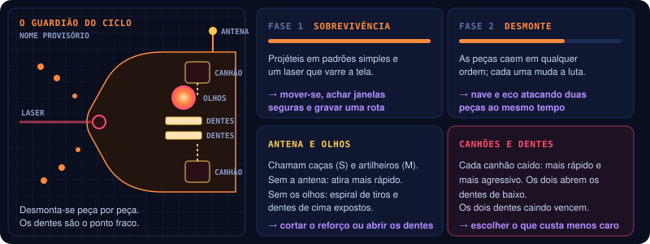
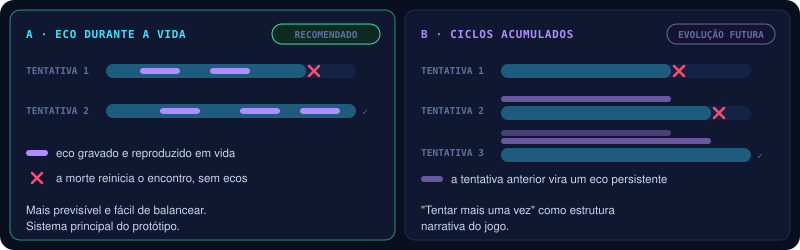

# ONE MORE TIME | Chefe e estrutura das runs

O chefe do protótipo, fase a fase, e como os encontros de uma run ensinam e combinam as mecânicas.

## O Guardião do Ciclo *(nome provisório)*

O protótipo tem **um único chefe**, desenhado para mostrar o potencial da mecânica temporal: uma máquina
de combate que protege uma passagem temporal. O núcleo fica blindado durante a maior parte do encontro.

| Fase | Nome | O que acontece | O jogador aprende |
|---|---|---|---|
| 1 | **Sobrevivência** | Projéteis em padrões simples; um laser varre a tela | Mover-se, achar janelas seguras e gravar uma rota |
| 2 | **Preparação** | Dois geradores laterais protegem o núcleo | Gravar tiros contra um gerador e atacar o outro enquanto o eco repete |
| 3 | **Sincronização** | Os dois geradores precisam cair numa janela curta; aí o núcleo fica vulnerável | Coordenar os disparos da nave com os do eco, vivo durante o padrão de projéteis |
| 4 | **Última chance** | Com pouca vida, mais ataques e janelas de vulnerabilidade menores | Aproveitar os ecos já criados para fechar o combate |

> **Critério de sucesso:** o chefe é vencível com uma boa sequência temporal, mas **não exige combinação
> pixel-perfect**. O desafio vem da leitura de padrões e do planejamento.

### No protótipo atual

Uma versão mínima com as **fases 1 a 3** (prefab `Guardian`, regras em `GuardianModel`). A fase 4 não existe.
O Guardião entra pela direita em 2,5 s, com a tela parada, e fica na borda direita, ocupando o terço direito
da tela.

Ele usa o modelo de blockout do designer (`Enemie_Boss_BlockOut`), **visto de cima**: os dois braços-canhão
viram duas **mandíbulas**, uma em cima e outra embaixo, apontadas para a nave; a cabeça fica entre elas, ao
fundo, com o **visor** vermelho virado para a nave. A leitura é a de um portão com duas mandíbulas, a máquina
que protege a passagem.

| Peça do modelo | No combate |
|---|---|
| Ponta de cada mandíbula | Um **gerador** (losango laranja): o de cima e o de baixo |
| Visor | O **núcleo**, alcançável pelo vão entre as mandíbulas |
| Boca | De onde saem os tiros das fases |
| Corpo e mandíbulas | **Blindagem** |

Para tudo bater com o que aparece na tela, os colisores ficam no plano de jogo, na posição em que cada peça é
vista pela câmera; o modelo fica logo atrás desse plano. Os geradores ficam a 2,9 u acima e abaixo do centro.

| Parte | Como funciona |
|---|---|
| **Blindagem** (corpo e mandíbulas) | Absorve todos os tiros e fere a nave que encostar nela |
| **Núcleo** | 120 de vida. Absorve os tiros enquanto o escudo âmbar está à vista; só toma dano quando fica vulnerável |
| **Geradores** (cima e baixo) | 12 de vida cada. Derrubar o primeiro abre uma **janela**; se o segundo cai dentro dela, o núcleo fica **vulnerável por 4 s**. Se a janela fecha com um gerador de pé, o que caiu volta com a vida cheia |
| **Volta dos geradores** | Quando a vulnerabilidade acaba, os dois geradores voltam com a vida cheia |

| Fase | No protótipo |
|---|---|
| 1 · Sobrevivência | 12 s com tudo blindado. Leque de 5 tiros mirados na nave a cada 1,4 s. O laser varre de uma borda até perto do meio da tela, alternando a metade de cima e a de baixo: aviso de 0,9 s, varredura de 2,2 s, pausa de 1,6 s |
| 2 · Preparação | Geradores expostos, janela **generosa de 6 s**. Rajada de 3 tiros mirados a cada 1,2 s. A primeira vez que o núcleo fica vulnerável encerra a fase: quando a vulnerabilidade acaba, começa a fase 3 |
| 3 · Sincronização | A mesma regra com janela **curta de 2,5 s**. Um anel de 14 tiros a cada 1,3 s, que gira um pouco a cada anel. Repete até o núcleo cair |

O núcleo destruído derrota o Guardião, e **essa é a vitória do encontro**. Pontuação: 250 por gerador
derrubado e 5000 pelo núcleo. O HUD mostra a vida do núcleo, os dois geradores, a fase, a janela e o
tempo de vulnerabilidade → [07](07-controles-e-interface.md).

**Combos no Guardião** → [03](03-combate.md):

| Combo | No Guardião |
|---|---|
| **Synchronized Strike** | Um gerador cai pela nave e o outro por um eco, com até 2,5 s entre as quedas, e o núcleo abre. O escudo cai pela regra de sempre; o combo dá o aviso "SYNCHRONIZED STRIKE" no HUD e 1000 pontos. Na fase 3 a janela do Guardião também é de 2,5 s, então toda abertura feita com nave e eco conta; na fase 2 (janela de 6 s) as quedas precisam estar mais próximas |
| **Crossfire** | A nave e um eco acertando o mesmo gerador, ou o núcleo vulnerável, com até 1 s de diferença: +3 de dano combinado |

Derrubar os dois geradores só com a nave ainda abre o núcleo, mas não é Synchronized Strike.

Todos os números são valores de partida para testar, no prefab `Guardian`.

*Por quê:* a janela é o que pede o eco. Grave os tiros contra um gerador (a fase 1, com tudo blindado, é
um bom momento) e invoque o eco quando os geradores abrirem, atacando o outro com a nave.

## Estrutura das runs

Runs curtas, com encontros que introduzem e depois combinam as mecânicas.

| Encontro | Conteúdo | Objetivo de design |
|---|---|---|
| 1. **Primeiro ciclo** | Inimigos simples e obstáculos básicos → [04](04-inimigos-e-ondas.md) | Ensinar movimento, tiro e gravação |
| 2. **Armadilha** | Laser e interruptor → [05](05-armadilhas-gadgets-puzzles.md) | Ensinar a interação entre eco e cenário |
| 3. **Combinação** | Inimigos, armadilha e gadget | Ensinar combos temporais |
| 4. **Guardião** | O chefe | Testar o domínio da mecânica |

No protótipo, os encontros podem ser segmentos de **uma única fase**, sem mapa de progressão.

**No protótipo atual**, a cena `Arena_01` encadeia três encontros (`StageDirector`):

| Ordem | Encontro | Começa quando | Termina quando |
|---|---|---|---|
| 1 | **Primeiro ciclo** — ondas → [04](04-inimigos-e-ondas.md) | A cena carrega | 4 s depois da última onda, sem inimigo vivo na tela |
| 2 | **Armadilha** — o corredor de armadilhas → [05](05-armadilhas-gadgets-puzzles.md) | O encontro 1 termina; o corredor entra pela direita | A nave passa do laser preso ao interruptor |
| 4 | **Guardião** | O corredor sai da tela (rolagem acelerada para 6 u/s) | O núcleo é destruído: vitória |

O encontro 3, **Combinação**, ainda não existe. O `StageDirector` tem um campo `startAt` para começar
direto no corredor ou no Guardião ao testar.

## Progressão entre tentativas

A repetição deve reforçar o tema *One More Time*. Dois modelos estão em jogo:

| Modelo | Como funciona | Situação |
|---|---|---|
| **A — Eco durante a vida** | O jogador grava e reproduz enquanto está vivo. A morte reinicia o encontro | **Recomendado para o protótipo** |
| **B — Ciclos acumulados** | Ao reiniciar, o jogador deixa um eco persistente da tentativa anterior | Evolução futura |

**No protótipo atual** o modelo A está implementado: ao morrer, a cena recarrega depois de 2 s **no encontro em que a morte aconteceu** (ondas, corredor ou Guardião), sem ecos e com a pontuação zerada (`RunCheckpoint`). Derrotar o Guardião é a vitória.

*Por quê:* o modelo A é mais previsível e mais fácil de balancear. O modelo B pode entrar depois, se
"tentar mais uma vez" também virar a estrutura narrativa do jogo.

## Perguntas em aberto

- [ ] O chefe tem quatro fases (§9) ou duas (tabela do §10, "chefe com duas fases de combate")? O protótipo tem as fases 1 a 3; a fase 4, Última chance, não está implementada.
- [ ] Nome definitivo do chefe — "O Guardião do Ciclo" é provisório.
- [ ] Confirmar o modelo A como sistema do protótipo (é o que está implementado).
- [x] O Guardião do Ciclo: versão mínima implementada (fases 1 a 3).
- [ ] Na fase 2 o núcleo também fica vulnerável quando os dois geradores caem; o v0.1 só fala de núcleo exposto na fase 3. Manter assim?
- [ ] Os geradores não recuperam vida enquanto estão de pé, então dá para enfraquecer os dois e derrubá-los em sequência dentro da janela curta sem o eco. Isso é aceitável, ou os geradores devem se regenerar? (Outra saída: só o Synchronized Strike abrir o núcleo → [03](03-combate.md).)
- [ ] O Guardião entrando fere a nave que estiver no caminho (dano de contato da blindagem). É justo, ou a blindagem só fere depois que ele para?
