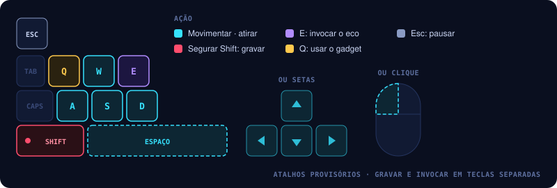
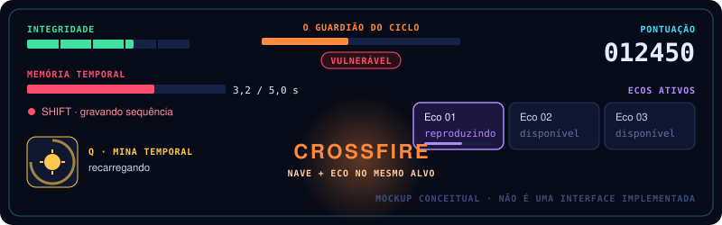

# ONE MORE TIME | Controles e interface

Como o jogador pilota, grava e invoca ecos sem parar de desviar — e o que o HUD precisa mostrar.

## Controles propostos

| Ação | Teclado |
|---|---|
| Movimentar nave | WASD ou setas |
| Disparo principal | Espaço ou botão esquerdo do mouse |
| Gravar sequência | Segurar Shift |
| Invocar eco | E |
| Usar gadget | Q |
| Pausar | Esc |

Os atalhos são provisórios.

*Por quê:* o que importa é **separar a gravação da reprodução**, para o jogador não invocar o eco sem
querer enquanto tenta desviar de uma armadilha.

No protótipo, estas ações estão em `Assets/_Project/Input/OneMoreTimeControls.inputactions` (mapa `Gameplay`), lidas só pelo `PlayerInputReader`. Q solta a mina temporal → [05](05-armadilhas-gadgets-puzzles.md).

## HUD

*Mockup conceitual — não representa uma interface implementada.*

O HUD do protótipo (UI Toolkit: `Hud.uxml` e `Hud.uss`) já mostra integridade, memória temporal com o
tempo gravado, os três espaços de eco, a pontuação, o gadget com a recarga ("Q · pronta" ou "recarga 1,2 s")
e as mensagens de pausa, derrota e vitória ("GUARDIÃO DERROTADO", com pontuação, abates e combos). Com o
Guardião em cena, um painel no topo mostra a vida do núcleo, os dois geradores, a fase e o estado do núcleo:
blindado, protegido pelos geradores, a janela aberta quando um gerador cai, ou vulnerável com o tempo que resta.

O **aviso de combo** aparece no alto da tela, no centro, por 1,4 s, como no mockup: o nome do combo e o que o
causou, com os pontos → [03](03-combate.md).

| Combo | Aviso |
|---|---|
| Crossfire | "CROSSFIRE" · "NAVE + ECO NO MESMO ALVO · +100" |
| Synchronized Strike | "SYNCHRONIZED STRIKE" · "NAVE + ECO NOS GERADORES · ESCUDO DESATIVADO · +1000" |

O mesmo combo de novo enquanto o aviso está na tela conta "×2", "×3"; um Crossfire não cobre um Synchronized
Strike que ainda está à vista. A duração fica em `HUD` → `HudController`.

O HUD mostra com clareza:

| Elemento | Por que o jogador precisa |
|---|---|
| Vida restante (integridade) | Saber quanto risco ainda pode correr |
| Estado e duração da gravação (memória temporal) | Planejar a sequência sem olhar o relógio |
| Quantidade de ecos ativos | Saber o que já está trabalhando por ele |
| Gadget equipado e recarga | Saber quando pode usar de novo |
| Vida do chefe e indicação de vulnerabilidade | Saber quando atacar |
| Feedback de combo temporal ativado | Entender o que funcionou → [03](03-combate.md) |

## Perguntas em aberto

- [ ] Suporte a controle: "pode vir depois" — entra na jam?
- [ ] Mapeamento definitivo das teclas no Input System.
- [ ] O aviso de combo usa laranja, como o mockup; laranja também é a cor de perigo → [08](08-direcao-visual-e-sonora.md). Fica assim, ou o combo ganha uma cor própria?
