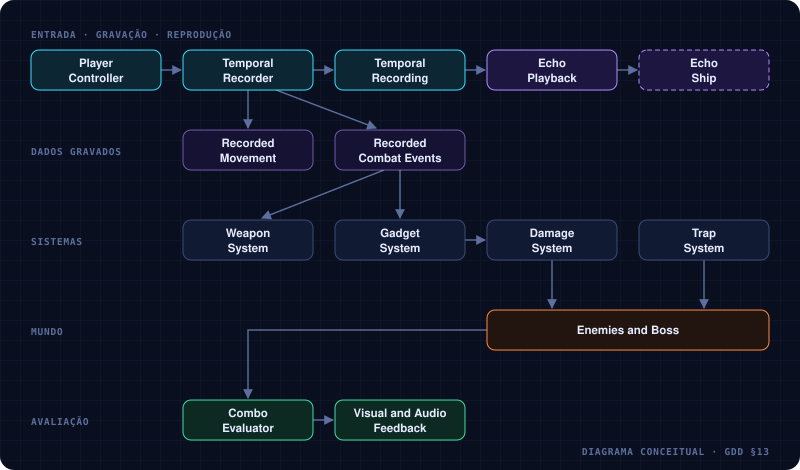

# ONE MORE TIME | Arquitetura técnica

A arquitetura sugerida para Unity: quem grava, quem reproduz, e como o eco conversa com os outros sistemas.

A implementação é **modular**: o sistema temporal não depende diretamente da lógica de cada inimigo ou armadilha.



*Diagrama conceitual — nenhum destes componentes existe ainda no projeto.*

## Componentes principais

| Componente | Responsabilidade |
|---|---|
| `PlayerController` | Movimento e entrada do jogador |
| `TemporalRecorder` | Captura as amostras e os eventos |
| `TemporalRecording` | Armazena a sequência gravada |
| `EchoPlayback` | Reproduz a sequência em ordem temporal |
| `WeaponSystem` | Gerencia disparos e projéteis |
| `GadgetSystem` | Ativa e registra gadgets |
| `TrapController` | Controla lasers, interruptores e armadilhas |
| `EnemyController` | Movimento e comportamento dos inimigos |
| `BossController` | Fases, ataques e pontos fracos |
| `ComboEvaluator` | Detecta as condições dos combos temporais |

## Como armazenar a gravação

Uma amostra de movimento:

```csharp
public struct EchoSample
{
    public float time;
    public Vector2 position;
    public float rotation;
}
```

Disparos e gadgets ficam numa lista separada de eventos, cada um com seu instante relativo à gravação:

```csharp
public struct EchoEvent
{
    public float time;
    public EchoEventType type;
    public Vector2 position;
    public Vector2 direction;
}
```

`EchoEventType` é um enum com os tipos de evento que o protótipo suporta, como disparo e uso de gadget.

| Regra | Detalhe |
|---|---|
| Taxa de amostragem | Fixa, não a cada frame — **20 amostras por segundo** costuma bastar para começar |
| Posições entre amostras | A reprodução interpola |
| Eventos | Respeitam o instante original e disparam **uma única vez** |
| Relógio | A reprodução usa o tempo decorrido do próprio eco |
| Projéteis do eco | Nascem no ponto e na direção registrados; as colisões são avaliadas no estado **atual** do mundo |

*Por quê:* gravar dados, e não o mundo, é o que mantém a regra fundamental barata de implementar →
[02](02-eco-temporal.md#regra-fundamental).

## Perguntas em aberto

- [ ] Lista final de valores de `EchoEventType`.
- [ ] Com o mundo em 3D (2.5D), `EchoSample` e `EchoEvent` continuam com `Vector2`, ou passam a `Vector3`? Depende de a nave se mover só num plano → [08](08-direcao-visual-e-sonora.md).
